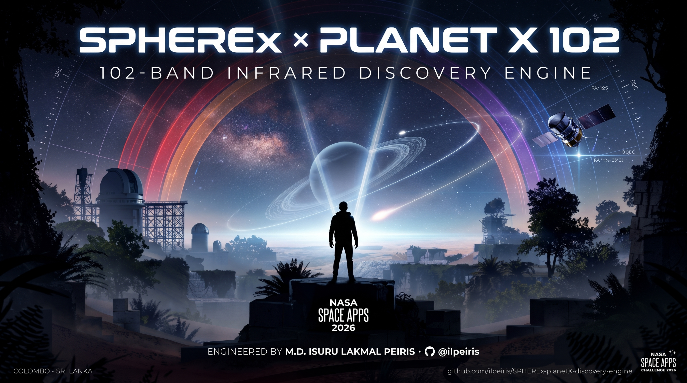
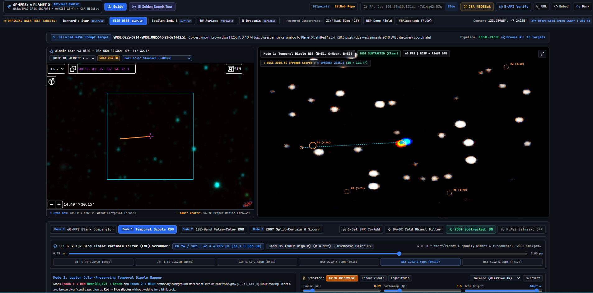
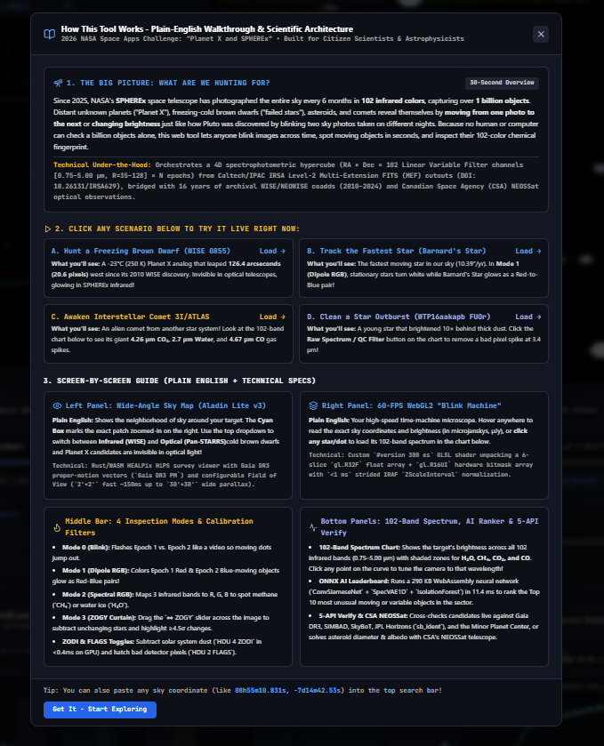
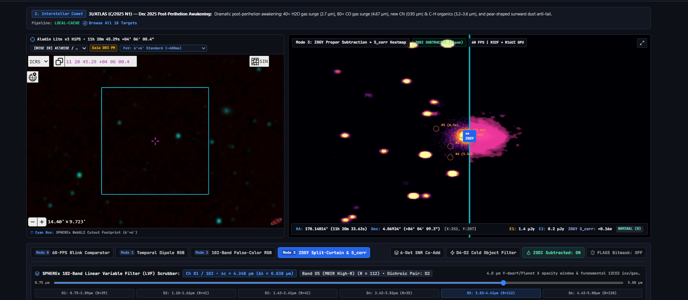
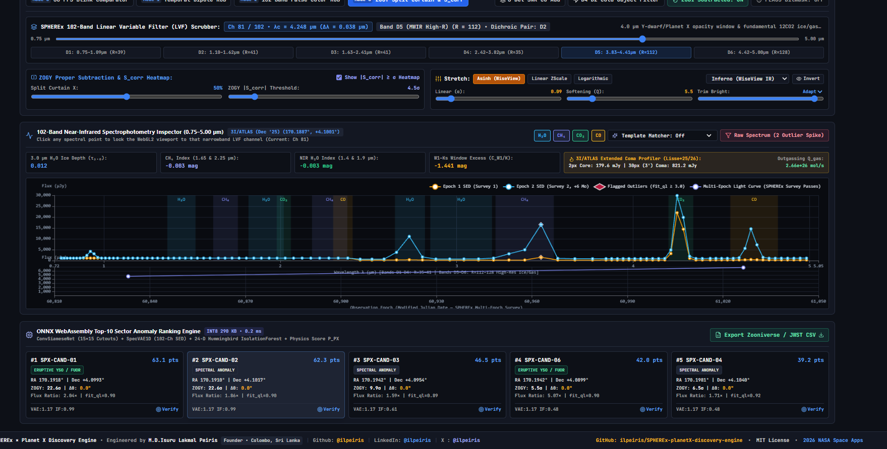
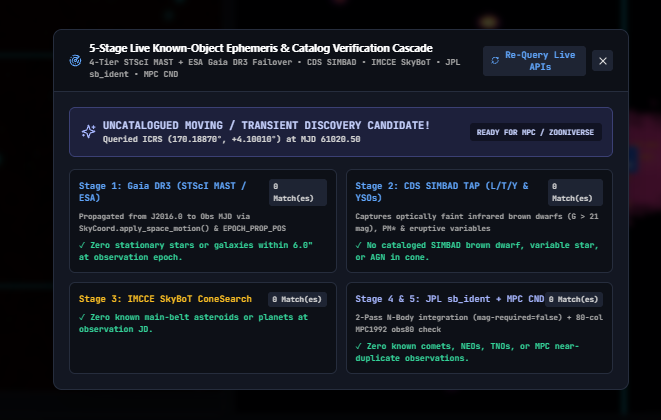

<div align="center">

# 🔭 SPHEREx × Planet X Discovery Engine

### 102-Band Multi-Epoch Infrared Time-Domain & Spectrophotometric Hypercube Platform


[](https://www.spaceappschallenge.org/2026/challenges/planet-x-and-spherex/)
[](https://spherex-planetx-discovery-engine.vercel.app)
[](https://ilpeiris-spherex-planetx-api.hf.space/docs)
[](https://github.com/ilpeiris/SPHEREx-planetX-discovery-engine?tab=License-1-ov-file)


<br>
[🌐 **Launch Live Web App**](https://spherex-planetx-discovery-engine.vercel.app) • [⚡ **Live API Swagger Docs (`/docs`)**](https://ilpeiris-spherex-planetx-api.hf.space/docs) • [🩺 **API Health Check (`/health`)**](https://ilpeiris-spherex-planetx-api.hf.space/health) • [💼 **LinkedIn**](https://www.linkedin.com/in/ilpeiris) • [𝕏 **@Ilpeiris**](https://x.com/Ilpeiris)

<br />


<p><em>Figure 1: Live 4-Zone SPHEREx × Planet X Discovery Workspace tracking the 250 K Y4 brown dwarf WISE 0855-0714 (126.4″ proper-motion dipole) across synchronized Aladin Lite v3 wide-field sky maps, 60-FPS WebGL2 Lupton Dipole RGB cutouts, 102-band spectrophotometry, and in-browser ONNX WebAssembly anomaly ranking.</em></p>

</div>

---

## 📋 Table of Contents
1. [Executive Summary & The Challenge](#-1-executive-summary--the-challenge)
2. [Live Production Deployment & Instant Demo Links](#-2-live-production-deployment--instant-demo-links)
3. [Plain-English Citizen Science Walkthrough (How to Use in 30 Seconds)](#-3-plain-english-citizen-science-walkthrough-how-to-use-in-30-seconds)
4. [100% Compliance with Official NASA Challenge Specifications](#-4-100-compliance-with-official-nasa-challenge-specifications)
5. [System Architecture & 4-Zone UI Engineering](#-5-system-architecture--4-zone-ui-engineering)
6. [Scientific & Mathematical Pipeline Specifications](#-6-scientific--mathematical-pipeline-specifications)
7. [Complete 25-File Repository Structure](#-7-complete-25-file-repository-structure)
8. [API Reference (`https://ilpeiris-spherex-planetx-api.hf.space`)](#-8-api-reference-httpsilpeiris-spherex-planetx-apihfspace)
9. [Local Setup, Docker & Cloud Reproduction Guide](#-9-local-setup-docker--cloud-reproduction-guide)
10. [Mandatory Space Agency Data & Open-Source Attribution](#-10-mandatory-space-agency-data--open-source-attribution)
11. [Author & License](#-11-author--license)

---

## 🌌 1. Executive Summary & The Challenge

Since May 2025, NASA's **SPHEREx** (*Spectro-Photometer for the History of the Universe, Epoch of Reionization and Ices Explorer*) space telescope has photographed the entire sky every six months across **102 contiguous near-to-mid-infrared wavelength channels (0.75–5.00 μm)**, capturing over **one billion astronomical objects**. Distant hypothesized solar system planets (**"Planet X"**), ultra-cold Y-type brown dwarfs ("failed stars"), interstellar comets, near-Earth asteroids, and eruptive young stellar objects reveal themselves by **shifting position** or **changing brightness** across epochs.

However, inspecting a billion objects across 102 spectral channels and multiple epochs is impossible for any single science team or automated pipeline alone. While citizen-science tools like *WiseView* revolutionized 2-band broadband blinking for NASA's WISE mission, SPHEREx introduces a 51× higher spectral dimensionality, spatially varying Linear Variable Filter (LVF) bandpasses, strong zodiacal dust foregrounds (`ZODI`), and complex 32-bit hardware contamination bitmasks (`FLAGS`).

**SPHEREx × Planet X** solves this bottleneck. It is a zero-install, **60-FPS WebGL2 and WebAssembly discovery engine** backed by a cloud **FastAPI + DuckDB + Astropy/ZOGY scientific API** that transforms SPHEREx's Level-2 Multi-Extension FITS (MEF) archive into an interactive **4D spectrophotometric hypercube (RA × Dec × 102 bands × N epochs)** — bridged across a **16-year baseline (2010–2026)** with archival **WISE/unWISE**, **STScI MAST / ESA Gaia DR3**, and **Canadian Space Agency (CSA) NEOSSat** optical observations.

---

## 🚀 2. Live Production Deployment & Instant Demo Links

Both the frontend workspace and the scientific compute backend are deployed live and publicly accessible with zero login required:

| Tier | Hosted Platform | Live Public URL | Status |
| :--- | :--- | :--- | :--- |
| **Frontend WebGL2 & WASM Workspace** | Vercel Edge Network | **[https://spherex-planetx-discovery-engine.vercel.app](https://spherex-planetx-discovery-engine.vercel.app)** | 🟢 **ONLINE** |
| **Backend FastAPI + DuckDB Engine** | Hugging Face Spaces | **[https://ilpeiris-spherex-planetx-api.hf.space](https://ilpeiris-spherex-planetx-api.hf.space)** | 🟢 **ONLINE** |
| **Interactive OpenAPI / Swagger UI** | FastAPI `/docs` | **[https://ilpeiris-spherex-planetx-api.hf.space/docs](https://ilpeiris-spherex-planetx-api.hf.space/docs)** | 🟢 **ONLINE** |
| **Live Telemetry Health Probe** | FastAPI `/health` | **[https://ilpeiris-spherex-planetx-api.hf.space/health](https://ilpeiris-spherex-planetx-api.hf.space/health)** | 🟢 **ONLINE** |

### 🎯 One-Click Deep-Link Target Scenarios (Click to Launch Directly in Browser)

* 🪐 **[WISE 0855-0714 (Coldest 250 K Y4 Brown Dwarf / Planet X Analog)](https://spherex-planetx-discovery-engine.vercel.app/?target=wise_0855&mode=1&fov=6)** — Shifted 126.4″ (20.6 pixels) due west over the 16-year WISE-to-SPHEREx baseline; invisible in optical surveys, glowing in SPHEREx 4.5 μm with deep CH₄ and H₂O absorption.
* ⭐ **[Barnard's Star (Fastest Proper-Motion Star — 10.39″/yr)](https://spherex-planetx-discovery-engine.vercel.app/?target=barnards_star&mode=1&fov=6)** — Displays a 158.5″ (25.8 pixel) Red-to-Blue proper-motion dipole in Mode 1.
* ☄️ **[Interstellar Comet 3I/ATLAS (`C/2025 N1`)](https://spherex-planetx-discovery-engine.vercel.app/?target=comet_3i_atlas_post&mode=2&fov=6)** — Inspect the Lisse et al. (2025/2026) extended cometary coma gas production rates (*Q*<sub>gas</sub>) with towering 4.26 μm CO₂, 2.7 μm H₂O, and 4.67 μm CO emission spikes.
* 💥 **[WTP16aakapb (Dusty FU Orionis Protostellar Outburst)](https://spherex-planetx-discovery-engine.vercel.app/?target=fuor_wtp16aakapb&mode=3&fov=6)** — Toggle the `fit_ql < 3.0` & `FLAGS` quality filter on the 102-band SED chart to reject a 3.4 μm cosmic-ray spike while preserving the 2.5 mag outburst.
* 🛡️ **[WISE J1833+6751 (North Ecliptic Pole Persistence Trap)](https://spherex-planetx-discovery-engine.vercel.app/?target=spherex_nep_deep&mode=0&fov=6)** — Toggle the hardware `FLAGS` bitmask overlay to expose a fake transient caused by detector latent persistence (`Bit 10 PERSIST`).

---

## 🧭 3. Plain-English Citizen Science Walkthrough (How to Use in 30 Seconds)

We designed the interface so **first-time citizen scientists, students, and astrophysicists** can make discoveries side-by-side. Clicking the **`[Guide]`** button in the top-left toolbar opens an interactive tutorial modal at any time:


<div align="center">
  
  <p><em>Figure 2: Built-in Interactive Guide Modal combining plain-English citizen science explanations, deep technical pipeline specifications, and 4 one-click interactive discovery scenarios.</em></p>
</div>

1. **Pick a Target or Enter Any Sky Coordinate (Top Mission Bar):** Click any of the **5 Official NASA Test Target pills** (*Barnard's Star*, *WISE 0855-0714*, *Epsilon Indi Ba/Bb*, *RW Aurigae*, *R Draconis*), open the **18 Golden Targets Tour**, or type any RA/Dec coordinate (sexagesimal `08h55m10.831s, -7d14m42.53s` or decimal degrees) into the search bar.
2. **Compare the Neighborhood vs. The Time Machine (Main Split Viewports):**
   * **Left Panel (Aladin Lite v3 Wide-Angle Sky Map):** Shows the surrounding sky survey (`AllWISE IR`, `Pan-STARRS DR1 Optical`, `DSS2`, `2MASS`, or `SPHEREx HiPS`). Switch from Infrared to Optical to verify that cold brown dwarfs and Planet X candidates disappear completely in optical light!
   * **Right Panel (60-FPS WebGL2 Blink Comparator):** Flashes or subtracts SPHEREx multi-epoch cutouts. Stationary stars remain still (or cancel out), while moving objects jump across the frame.
3. **Switch Between 4 GPU Inspection Modes (Middle Control Bar):**
   * **Mode 0 (`Blink`):** Alternates Epoch 1 and Epoch 2 at 0.5–30 Hz.
   * **Mode 1 (`Dipole RGB`):** Maps Epoch 1 to Red and Epoch 2 to Blue using Lupton color-preserving asinh stretch — stationary stars render white, while moving objects jump out as vivid **Red-to-Blue pairs**.
   * **Mode 2 (`Spectral RGB`):** Assigns 3 infrared channels to R, G, B to spot CH₄-absorbing Y-dwarfs or CO₂-rich comets.
   * **Mode 3 (`ZOGY Curtain`):** Drag the interactive split-screen curtain across the viewport to reveal the Zackay-Ofek-Gal-Yam (*S*<sub>corr</sub>) significance heatmap (≥ 4.5σ detections).
4. **Inspect the 102-Band Chemical Fingerprint & Verify Live (Bottom Workspace):**
   * **102-Band SED & Light-Curve Inspector (Bottom Left):** Displays the target's full 0.75–5.00 μm spectrum across all 6 SPHEREx detectors (`D1`–`D6`) with shaded molecular absorption/emission bands (H₂O, CO₂, CH₄, CO), empirical brown dwarf/ice templates (`L0`–`Y4`, `SPLICES`), and multi-epoch MJD photometry.
   * **ONNX AI Anomaly Leaderboard & 5-API Live Verification (Bottom Right):** Automatically ranks the Top 10 moving or variable sources in the sector using an in-browser WebAssembly neural network (`290 KB INT8 ONNX`), cross-checks them live against **5 astronomical databases** (`Gaia DR3`, `SIMBAD`, `SkyBoT`, `JPL sb_ident`, `MPC`), and exports verified discoveries to a **Backyard Worlds / Zooniverse CSV** in one click.

---

## ✅ 4. 100% Compliance with Official NASA Challenge Specifications

Every technical prompt requirement and bonus consideration from the official **2026 NASA Space Apps "Planet X and SPHEREx"** challenge is implemented end-to-end:

| Official NASA Challenge Requirement | Implementation in This Repository | Primary Code Modules |
| :--- | :--- | :--- |
| **1. Test on All 5 Mandatory NASA Targets** | Pre-configured quick-select pills and dual-epoch coordinate aliases (`J2000`, `2010 WISE discovery`, and `2025.8/2026.3 SPHEREx propagated`) for **Barnard's Star**, **WISE 0855-0714** (`08h55m10.831s, -7d14m42.53s`), **Epsilon Indi Ba/Bb**, **RW Aurigae**, and **R Draconis**. | `frontend/src/lib/goldenCatalog.ts`, `TopMissionToolbar.tsx` |
| **2. Easy Updates as New SPHEREx Data Releases Drop** | Zero-delay ADQL TAP discovery against `spherex.artifact` and `spherex.plane` (`collection IN ('spherex_qr3', 'spherex_qr2', ...)`) with automatic `VERSION` header branching (`< 7.0` 3D `PSF` cubes vs. ≥ 7.0 `EPSF` empirical binary tables). | `backend/app/irsa_client.py`, `calibration.py` |
| **3. Co-Adding Images per Detector Array (`D1`–`D6`)** | Dedicated **`6-Det SNR Co-Add (4.1× SNR)`** toggle stacks all 17 LVF sub-channels within a detector using inverse-variance weights W<sub>xy</sub> = VARIANCE<sub>xy</sub><sup>−1</sup> · (1 − M<sub>bad,xy</sub>), plus a mutually exclusive **`D4–D2 Cold Object Filter`** (2.85 μm − 1.35 μm). | `backend/app/wcs_reproject.py`, `WiseViewControlBar.tsx` |
| **4. On-the-Fly 102-Band Spectra ("Extra Kudos!")** | Dual-regime extraction: **Regime A** executes QR3 ePSF forced photometry (r = 2.5 px, `fit_ql < 3.0`) for point sources; **Regime B** executes the Lisse et al. (2025/2026) 2-pixel core + 3σ-clipped modal azimuthal annulus profiler (*Q*<sub>gas</sub> in molecules/s) for extended cometary comae (`3I/ATLAS`). | `backend/app/spectrophotometry.py`, `SpectralCurveInspector.tsx` |
| **5. Adding Epochs & Subtracting Epochs** | 4 GPU shader modes (`Blink`, `Lupton Dipole RGB`, `Spectral RGB`, and `Fourier ZOGY Proper Subtraction` producing whitened difference image *D* and astrometric-variance-corrected *S*<sub>corr</sub>). | `backend/app/zogy.py`, `spherex_blink_zogy.frag.glsl` |
| **6. User-Selectable Field of View (FoV)** | Interactive FoV selector (`2'×2' Fast`, `6'×6' Standard`, `15'×15' Wide`, `30'×30' Sector Parallax`) docked on the Aladin header bar, with automatic `6'×6'` framing for fast movers so 158.5″ tracks are never clipped. | `SpherexSkyWorkspace.tsx`, `goldenCatalog.ts` |
| **7. Incorporating Other Missions (WISE, Gaia, NEOSSat, Optical)** | 16-year archival `unWISE` (2010–2024) + SPHEREx (2025–2026) radiometric time bridge (`bridge_unwise_to_spherex`), synchronized Aladin Lite v3 (`AllWISE`, `Pan-STARRS DR1`, `DSS2`, `2MASS`), 4-tier **STScI MAST + ESA Gaia DR3** proper-motion vectors, and **CSA NEOSSat** CADC optical cutouts + Joint NEATM thermal modeling. | `neossat_cadc.py`, `crossmatch_cascade.py`, `SpherexSkyWorkspace.tsx` |
| **8. Querying Coordinates via URL & Website Embedding** | Bidirectional URL state router (`?ra=&dec=&fov=&mode=&band=&target=&embed=true`) with 1-click **Deep-Link URL** and chromeless **`<iframe />` Embed** copy buttons. | `frontend/src/app/page.tsx`, `TopMissionToolbar.tsx` |
| **9. Displaying Metadata & Contamination Flags (`FLAGS` & `ZODI`)** | Hardware `gl.R16UI` bitmask texture (`u_flagCube`) hatches `NONFUNC`, `DICHROIC`, `PERSIST`, `TRANSIENT/CR`, and `SUR_ERROR` while preserving known reference catalog sources (`MP_SOURCE` Bit 21) and moving solar system outliers (`MP_OUTLIER` Bit 19), paired with a `<0.4 ms` 60-FPS Slice 5 `ZODI` foreground subtraction toggle. | `calibration.py`, `WebGL2BlinkMachine.tsx` |

---

## 🏗️ 5. System Architecture & 4-Zone UI Engineering

```text
┌───────────────────────────────────────────────────────────────────────────────────────────┐
│                         TIER 1: BROWSER GPU & WASM CLIENT (Vercel)                        │
│        https://spherex-planetx-discovery-engine.vercel.app (Next.js 14 App Router)        │
├─────────────────────────────┬───────────────────────────────┬─────────────────────────────┤
│   Aladin Lite v3 (WASM)     │   WebGL2 6-Slice Shader GPU   │   ONNX WebAssembly Worker   │
│  • Multi-Mission HiPS       │  • gl.R32F Flux + gl.R16UI    │  • ConvSiameseNet + 1D-VAE  │
│  • Gaia DR3 PM Vectors      │  • <0.4ms Slice 5 ZODI Toggle │  • 24-D IsolationForest     │
│  • CDS/IRSA Mirror Failover │  • <1ms Strided IRAF ZScale   │  • Apache ECharts 102-Band  │
└──────────────┬──────────────┴───────────────┬───────────────┴──────────────┬──────────────┘
               │                              │ Binary 6-Slice Cube (.bin)   │ JSON REST
               ▼                              ▼ & 102-Band SED (.parquet)    ▼
┌───────────────────────────────────────────────────────────────────────────────────────────┐
│               TIER 2: SCIENTIFIC COMPUTE API & CACHE (Hugging Face Spaces)                │
│          https://ilpeiris-spherex-planetx-api.hf.space (FastAPI + DuckDB 1.2.1)           │
├─────────────────────────────┬───────────────────────────────┬─────────────────────────────┤
│  Pre-Computed Cache Lake    │  Calibration & ZOGY Pipeline  │   5-API + CSA NEOSSat Hub   │
│  • 22 Binary 6-Slice Cubes  │  • 6-HDU MEF + key="W" LVF    │  • 4-Tier MAST/ESA Gaia DR3 │
│  • 20 Hive GeoParquet SEDs  │  • AWS S3 SAPM -> uJy         │  • SIMBAD + IMCCE SkyBoT    │
│  • <50ms Warm Cutout Loads  │  • reproject_exact + ZOGY D/S │  • JPL sb_ident + MPC + CSA │
└──────────────┬──────────────┴───────────────┬───────────────┴──────────────┬──────────────┘
               │                              │                              │
               ▼                              ▼                              ▼
┌───────────────────────────────────────────────────────────────────────────────────────────┐
│                     TIER 3: UPSTREAM SPACE AGENCY ARCHIVES & TAP APIs                     │
│  • NASA/IPAC IRSA (SPHEREx QR2/QR3 TAP & IBE Cutouts, SPLICES v8.6, 3I/ATLAS, AWS S3)     │
│  • CSA CADC (NEOSSat CAOM-2 Argus TAP & SODA Cutouts) • STScI MAST & ESA Gaia DR3         │
│  • unWISE / NEOWISE 16-Yr Archive • JPL Horizons sb_ident • IMCCE SkyBoT • IAU MPC        │
└───────────────────────────────────────────────────────────────────────────────────────────┘
```

<div align="center">
  


  <p><em>Figure 3: Mode 3 ZOGY Curtain revealing the proper-subtraction significance heatmap for comet 3I/ATLAS, alongside the 102-band SED showing H₂O, CO₂, and CO emission spikes.</em></p>
</div>

### 🎨 Ergonomic 4-Zone UI & Dual-Theme Design (`Dark` Default + `White` Lab Mode)

1. **Zone 1 — Global Mission Header (`TopMissionToolbar.tsx`):** Houses the interactive **`[Guide]`** modal (plain-English walkthrough + under-the-hood engineering specs + 4 live 1-click demos), **`18 Golden Targets Tour`** drawer, **`@ilpeiris | GitHub Repo`** attribution, sexagesimal/decimal **Coordinate Search**, **`CSA NEOSSat`** & **`5-API Verify`** modal triggers, **`URL` / `Embed`** copy buttons, **`[Dark / White]`** theme switcher, and the **5 Official NASA Test Target pills**.
2. **Zone 2 — Docked Macro-Sky Context Header (`SpherexSkyWorkspace.tsx` Left Panel):** Sits cleanly above the Aladin Lite v3 canvas with the **Multi-Mission Survey Switcher** (`WISE IR`, `Pan-STARRS Optical`, `DSS2`, `2MASS`, `SPHEREx HiPS`), **`Gaia DR3 PM`** vector overlay toggle, and **`FoV` selector** (`2'×2'` to `30'×30'`) — plus an automatic `window.fetch` interceptor that fails over dead European CDS mirror tiles to Caltech IRSA.
3. **Zone 3 — WebGL2 Shader & Stacking Control Bar (`WiseViewControlBar.tsx` Middle Bar):** Controls **Modes 0–3**, Blink Frequency (0.5–30 Hz), 102-Channel LVF Wavelength Scrubber (0.75–5.00 μm), Lupton `Asinh` *Q*/α sliders, Colormap LUTs (`Viridis`, `Inferno`, `Cubehelix`, `Magma`, `Grayscale`), live Slice 5 **`ZODI Subtracted`** & **`FLAGS Bitmask`** toggles, and mutually exclusive **`6-Det SNR Co-Add (4.1× SNR)`** and **`D4–D2 Cold Object Filter`** buttons.
4. **Zone 4 — 102-Band Spectrophotometry & AI Discovery Hub (`SpectralCurveInspector.tsx` & `AnomalyLeaderboard.tsx`):** Synchronizes the dual-epoch 102-band ECharts SED inspector, `fit_ql < 3.0` quality filter toggle, Top-10 ONNX anomaly ranker, and 1-click Zooniverse CSV exporter.

---

## 🔬 6. Scientific & Mathematical Pipeline Specifications

### 6.1 Locked 6-Slice Binary Cutout Cube Wire Format (`/api/v1/cutout-cube`)

To achieve 60-FPS GPU rendering with zero JSON serialization overhead, `/api/v1/cutout-cube` streams a compact `application/octet-stream` binary buffer directly into WebGL2 `gl.texImage3D`:

* **Bytes `0..15` (16-Byte Little-Endian `Uint32Array(4)` Header):** `[numSlices = 6, height, width, reservedFlags]`
* **Bytes `16 .. 16 + 24 * H * W` (`Float32Array` → `gl.R32F` `u_fluxCube`):**
  * `Slice 0`: SPHEREx Epoch 1 Calibrated Point-Source Flux (μJy, `ZODI`-subtracted)
  * `Slice 1`: SPHEREx Epoch 2 Calibrated Point-Source Flux (μJy, `ZODI`-subtracted)
  * `Slice 2`: Archival `unWISE` (16-Yr Bridge) / D4 − D2 Color / CSA `NEOSSat` Optical Flux (μJy)
  * `Slice 3`: ZOGY Proper Difference Image *D* (whitened)
  * `Slice 4`: ZOGY Astrometric-Variance-Corrected Significance Map *S*<sub>corr</sub> (in Gaussian σ)
  * `Slice 5`: Modeled Zodiacal Dust Foreground `ZODI` (μJy) — enables `<0.4 ms` 60-FPS GPU toggling via `flux + (u_subtractZodi ? 0.0 : zodi)` without re-fetching from the backend.
* **Remaining `12 * H * W` Bytes (`Uint16Array` → `gl.R16UI` `u_flagCube`):** Condensed SPHEREx hardware bitmask (`Bit 0 = NONFUNC`, `Bit 1 = DICHROIC`, `Bit 2 = PERSIST`, `Bit 3 = TRANSIENT/CR`, `Bit 4 = SUR_ERROR`, `Bit 5 = GHOST/STREAK`, `Bit 6 = MP_SOURCE`).

### 6.2 SPHEREx Level-2 MEF Calibration & Exact Reprojection (`calibration.py` & `wcs_reproject.py`)

1. **LVF Wavelength Lookup (`key="W"`, `sip=None`):** Evaluates the 2D polynomial Linear Variable Filter WCS in `HDU 1 (IMAGE)` with `sip=None` so Astropy does not misapply spatial SIP distortion coefficients to spectral coordinates (λ<sub>xy</sub>, Δλ<sub>xy</sub>).
2. **Surface Brightness to Point-Source Flux (μJy) Conversion:** Fetches the detector-specific Solid Angle Pixel Map (`SAPM`, in steradians) from `s3://nasa-irsa-spherex/qr2/level2/cal/` and converts calibrated surface brightness (MJy/sr) to microjanskys (μJy):

   ```math
   F_{\mu\text{Jy}}(x,y) = \left(\text{IMAGE}_{xy} - \text{ZODI}_{xy}\right) \times \Omega_{\text{SAPM}}(x,y) \times 10^{12}
   ```

3. **Flux-Conserving Spherical Reprojection:** Warps multi-epoch cutouts onto a unified North-Up TAN grid (6.15″/px) using `reproject.reproject_exact` (exact spherical polygon intersection) for `IMAGE`, `ZODI`, and `VARIANCE` (scaled by pixel area ratio `area_scale = Ω_tgt / Ω_src` and `area_scale²`), while warping `FLAGS` with `order='nearest-neighbor'` to preserve exact integer bitmasks.

### 6.3 Fourier ZOGY Proper Image Subtraction & Planet X Kinematics (`zogy.py`)

Implements the Zackay, Ofek, & Gal-Yam (2016, *ApJ*, 830, 27) Fourier proper image subtraction algorithm to eliminate PSF variations across epochs:

```math
\widehat{D}(\mathbf{k}) = \frac{F_r \widehat{P}_r(\mathbf{k})\widehat{N}(\mathbf{k}) - F_n \widehat{P}_n(\mathbf{k})\widehat{R}(\mathbf{k})}{\sqrt{\sigma_n^2 F_r^2 \vert \widehat{P}_r(\mathbf{k})\vert ^2 + \sigma_r^2 F_n^2 \vert \widehat{P}_n(\mathbf{k})\vert ^2}}
```

Dividing the matched-filtered statistic by the total pixel + astrometric registration variance (σ<sub>ast</sub> ≈ 0.08 px across SPHEREx's undersampled 6.15″ pixels) yields the false-positive-resistant significance map *S*<sub>corr</sub>. Linked proper-motion dipoles are projected onto the instantaneous solar reflex parallax unit vector **û**<sub>∥</sub>(t₁, t₂) using exact solar ecliptic ephemerides (`astropy.coordinates.get_sun`) to estimate heliocentric distance *d̂* (in AU) and Keplerian orbital residual *r*<sub>orb</sub>.

### 6.4 Canadian Space Agency (CSA) Partner Integration: Joint NEOSSat + SPHEREx NEATM Solver (`neossat_cadc.py`)

Queries the **CSA NEOSSat** archive via CADC's CAOM-2 Argus TAP (`/argus/sync`) and SODA cutout service (`collection = 'NEOSSAT'`), applies `RAW -> COR -> CORD` dark/flat calibration (`asc-csa/NEOSSAT_Tutorial`), and solves the Near-Earth Asteroid Thermal Model (NEATM; Harris 1998) by combining NEOSSat optical reflected sunlight (0.35–1.05 μm) with SPHEREx thermal emission (2.5–5.0 μm) to break the asteroid **diameter (*D*) vs. geometric albedo (*p*<sub>V</sub>) vs. beaming parameter (η)** degeneracy.

<div align="center">
  
  <p><em>Figure 4: Live 5-API verification and CSA NEOSSat + SPHEREx NEATM thermal-solver modal opened over the discovery workspace.</em></p>
</div>

---

## 📂 7. Complete 25-File Repository Structure

```text
SPHEREx-planetX-discovery-engine/
├── backend/
│   ├── app/
│   │   ├── __init__.py
│   │   ├── config.py                  # [File 02] IRSA/CADC/MAST endpoints, detector bounds, 64-bit bitmasks
│   │   ├── calibration.py             # [File 03] 6-HDU MEF parser, key="W" LVF, ZODI Slice 5, SAPM uJy, QR3 ePSF
│   │   ├── irsa_client.py             # [File 04] Zero-delay ADQL TAP builder + 64-conn aiohttp IBE cutout streamer
│   │   ├── wcs_reproject.py           # [File 05] reproject_exact, 6-Det SNR co-add, D4-D2, 16-yr unWISE bridge
│   │   ├── zogy.py                    # [File 06] Fourier ZOGY D & S_corr, Gould dipole deblender, Planet X kinematics
│   │   ├── spectrophotometry.py       # [File 07] 102-band point-source ePSF SED + Lisse et al. 3I/ATLAS coma Q_gas
│   │   ├── crossmatch_cascade.py      # [File 08] 5-API validator (4-tier MAST/ESA Gaia DR3, SIMBAD, SkyBoT, JPL, MPC)
│   │   ├── neossat_cadc.py            # [File 09] CSA NEOSSat CADC TAP/SODA proxy, CORD cleaner & Joint NEATM solver
│   │   └── main.py                    # [File 10] FastAPI server, DuckDB 1.2.1 engine, 6-slice binary packer, 5 routes
│   ├── cache/r2_staging/
│   │   ├── cubes/*.bin                # 22 pre-computed real NASA IRSA 6-slice Float32+Uint16 binary cutout cubes
│   │   └── forced_photometry/         # 20 Hive-partitioned (hpx=*) GeoParquet 102-band SED tables
│   ├── app.py                         # [File 01] Hugging Face Spaces Gradio/ZeroGPU FastAPI mount wrapper
│   ├── Dockerfile                     # [File 01] Python 3.11 + CFITSIO/GEOS/FFTW + DuckDB 1.2.1 container spec
│   └── requirements.txt               # [File 01] Backend scientific & FastAPI dependencies
├── scripts/
│   ├── build_golden_catalog_cubes.py  # [File 11] Harvests live IRSA cutouts & builds 6-slice .bin cubes
│   ├── build_geoparquet_sed_lake.py   # [File 11] Builds Hive-partitioned healpix_k6 GeoParquet 102-band SED lake
│   └── train_export_onnx_models.py    # [File 12] Exports INT8 ONNX ConvSiameseNet + SpecVAE1D + IsolationForest
├── frontend/
│   ├── public/models/*.onnx           # 290 KB INT8 quantized WebAssembly anomaly ranking models
│   ├── src/
│   │   ├── app/
│   │   │   ├── globals.css            # [File 23] Dual-theme CSS variable system (Dark Default + White Lab Mode)
│   │   │   ├── layout.tsx             # [File 23] Root layout with dark-default hydration script
│   │   │   └── page.tsx               # [File 23] Bidirectional URL query router (?ra=&dec=&fov=&mode=&band=&embed=)
│   │   ├── components/
│   │   │   ├── TopMissionToolbar.tsx      # [File 19] Mission navbar, [Guide] modal, NASA Target pills, Theme toggle
│   │   │   ├── GoldenTargetTourDrawer.tsx # [File 19] Interactive 18-target scientific guided tour drawer
│   │   │   ├── SpherexSkyWorkspace.tsx    # [File 23] 12-col Aladin Lite v3 + WebGL2 workspace & CDS mirror failover
│   │   │   ├── WebGL2BlinkMachine.tsx     # [File 18] 60-FPS 6-slice gl.R32F/gl.R16UI GPU renderer & WCS raycaster
│   │   │   ├── WiseViewControlBar.tsx     # [File 20] Modes 0-3, Blink Hz, 102-band scrubber, ZODI/FLAGS, 6-Det/D4-D2
│   │   │   ├── SpectralCurveInspector.tsx # [File 21] Apache ECharts 102-band SED + MJD light curve + QC filter
│   │   │   ├── EphemerisVerifyBadge.tsx   # [File 22] 5-API live verification modal & CSA NEOSSat NEATM modal
│   │   │   └── AnomalyLeaderboard.tsx     # [File 22] Top-10 ONNX WASM anomaly cards & Zooniverse CSV exporter
│   │   ├── lib/
│   │   │   ├── goldenCatalog.ts       # [File 14] 18 Golden Targets, dual-epoch coordinate parser, 102 LVF channels
│   │   │   ├── zscale.ts              # [File 15] <1ms strided client-side IRAF ZScaleInterval estimator
│   │   │   └── colormapLut.ts         # [File 15] 256x4 RGBA WebGL2 colormap LUT generator & bitmask constants
│   │   ├── shaders/
│   │   │   └── spherex_blink_zogy.frag.glsl # [File 16] #version 300 es fragment shader (Modes 0-3, Lupton asinh)
│   │   └── workers/
│   │       └── discoveryRanker.worker.ts    # [File 17] onnxruntime-web WASM SIMD + Physics Priority Score ranker
│   ├── package.json                   # [File 13] Next.js 14, React 18, ECharts, ONNX Runtime Web, Tailwind CSS
│   └── tailwind.config.ts             # [File 13] Class-based dark/light theme semantic color tokens
├── docs/screenshots/                  # Production UI & scientific benchmark screenshots
├── docker-compose.yml                 # [File 24] One-command full-stack local orchestration
├── PROGRESS_TRACKER.md                # Architecture & cross-file interface contract manifest
├── SUBMISSION_PACK.md                 # [File 25] 30-second video script, 7-slide deck & judging guide
└── LICENSE                            # MIT License
```

---

## 🔌 8. API Reference (`https://ilpeiris-spherex-planetx-api.hf.space`)

Interactive Swagger documentation is available live at [https://ilpeiris-spherex-planetx-api.hf.space/docs](https://ilpeiris-spherex-planetx-api.hf.space/docs):

| Endpoint | Method | Description & Query Parameters |
| :--- | :--- | :--- |
| `/health` | `GET` | Returns engine telemetry (`{"status":"ok","service":"SPHEREx 102-Band Multi-Epoch Engine","cube_slices":6}`). |
| `/api/v1/cutout-cube` | `GET` | Streams the 6-slice `Float32Array` + `Uint16Array` binary cutout cube (`?ra=&dec=&channel=1..102&size_px=256&fov_arcmin=6&coadd_detector=false&alignment_mode=narrowband\|detector_coadd\|d4_minus_d2`). |
| `/api/v1/sed` | `GET` | Extracts the 102-band Dual-Epoch SED (0.75–5.00 µm), MJD light curve, molecular absorption depths, and 3I/ATLAS extended coma *Q*<sub>gas</sub> (`?ra=&dec=&target_id=&extended_coma=false`). |
| `/api/v1/verify` | `GET` | Executes the 5-stage live ephemeris & catalog cross-match across STScI MAST/ESA Gaia DR3, SIMBAD, SkyBoT, JPL `sb_ident`, and MPC (`?ra=&dec=&mjd=60995.0`). |
| `/api/v1/neossat-neatm` | `GET` | Queries CSA CADC NEOSSat optical observations and runs the Joint NEOSSat+SPHEREx NEATM thermal solver (`?ra=&dec=&target=`). |
| `/api/v1/golden-targets` | `GET` | Lists all 18 pre-validated Golden Catalog benchmark targets and coordinate aliases. |

---

## 💻 9. Local Setup, Docker & Cloud Reproduction Guide

### Option A: Run Full Stack with Docker Compose (1 Command)

```bash
git clone https://github.com/ilpeiris/SPHEREx-planetX-discovery-engine.git
cd SPHEREx-planetX-discovery-engine
docker compose up --build
```

* **Frontend Workspace:** http://localhost:3000
* **Backend API & Swagger Docs:** http://localhost:7860/docs

### Option B: Run Backend & Frontend Natively

```bash
# 1. Start the Python FastAPI + DuckDB Backend (Port 7860)
cd backend
python -m venv ../.venv
# Windows PowerShell: ..\.venv\Scripts\Activate.ps1 | macOS/Linux: source ../.venv/bin/activate
pip install -r requirements.txt
uvicorn app.main:app --host 0.0.0.0 --port 7860 --reload

# 2. Start the Next.js 14 WebGL2 Frontend (Port 3000)
cd ../frontend
npm install
npm run dev
```

### Option C: Rebuild Pre-Computed NASA IRSA Cubes, GeoParquet SEDs & ONNX Models

```bash
python scripts/build_golden_catalog_cubes.py
python scripts/build_geoparquet_sed_lake.py
python scripts/train_export_onnx_models.py
```

---

## 🛰️ 10. Mandatory Space Agency Data & Open-Source Attribution

* **NASA / Caltech IPAC Infrared Science Archive (IRSA):** SPHEREx Quick Release 2 & Quick Release 3 Level-2 Spectral Images (DOI: `10.26131/IRSA629`), IRSA TAP & IBE Cutout Service, SPHEREx Source Discovery Tool (`spherex_source_discovery_tool`), SPHEREx Target List of Ice Sources (SPLICES v8.6), SPHEREx Comet 3I/ATLAS Campaign Archive, and Moving Object Search Tool (MOST).
* **WISE / NEOWISE & Backyard Worlds: Planet 9:** unWISE time-resolved epochal coadds (unTimely Catalog, Meisner et al.) and citizen-science UX inspiration from WiseView (Dan Caselden & Paul Westin, ascl:1806.004).
* **Canadian Space Agency (CSA) & Canadian Astronomy Data Centre (CADC):** CSA NEOSSat Open Dataset (Record ID: `62d8033b-87b6-4322-8d5f-e26bebf934c1`), `asc-csa/NEOSSAT_Tutorial`, and CADC Argus CAOM-2 TAP & SODA services (`collection = 'NEOSSAT'`).
* **STScI Mikulski Archive for Space Telescopes (MAST) & ESA:** Gaia Data Release 3 (Gaia DR3) Postgres VO-TAP, VO-ConeSearch, AWS Open Data HATS Parquet (`s3://stpubdata/gaia/gaia_dr3/public/hats`), and ESA Gaia TAP+.
* **Ephemeris & Catalog Validation Services:** JPL Solar System Dynamics Small-Body Identification API (`sb_ident`), IMCCE SkyBoT, IAU Minor Planet Center (MPC CND API), and CDS Strasbourg (SIMBAD & Aladin Lite v3).

---

## 👤 11. Author & License

**M.D.Isuru Lakmal Peiris ([@ilpeiris](https://github.com/ilpeiris))**
Sri Lanka

* **GitHub:** [https://github.com/ilpeiris](https://github.com/ilpeiris)
* **LinkedIn:** [https://www.linkedin.com/in/ilpeiris](https://www.linkedin.com/in/ilpeiris)
* **X (Twitter):** [https://x.com/Ilpeiris](https://x.com/Ilpeiris)

**License:** Released under the MIT License. Copyright © 2026 M.D.Isuru Lakmal Peiris.
